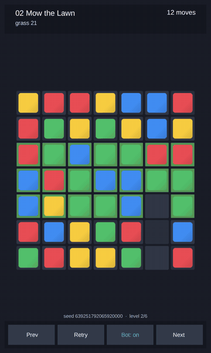
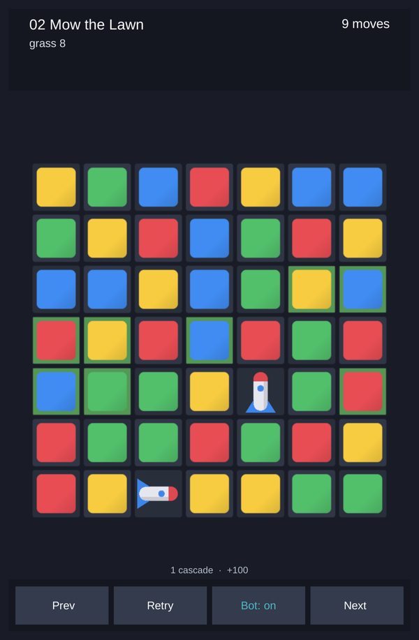
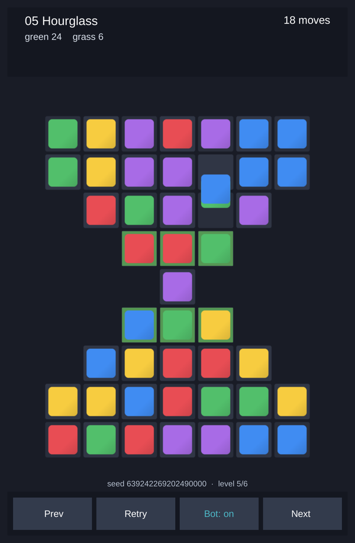
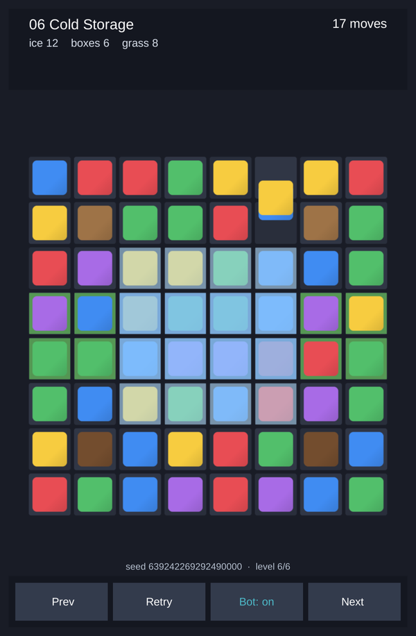

# Match3 Lab

[](https://github.com/RizgarOzan/match3-lab/actions/workflows/tests.yml)

[Play in the browser](https://rizgarozan.github.io/match3-lab/) (WebGL build, 8.96 MB gzipped, nothing to install).

Tools for tuning match-3 levels. The rules live in a plain C# core with no Unity reference,
levels are text files, and a bot simulator plays each level thousands of times in a few seconds to
rank levels by how hard they are for the bot. That ranks levels against each other; it doesn't
predict human win rates. There's a CLI, a Unity front end with editor windows, 60 core tests and
2 play-mode tests.

<p align="center">
  
</p>
<p align="center"><sub>The greedy bot playing level 2 in the WebGL build, 2.4× speed.</sub></p>

<p align="center">
  
  
  
</p>
<p align="center"><sub>Screenshots from the WebGL build with the bot playing (<code>?auto=1</code>). Every sprite is generated at start-up, so the project ships no art.</sub></p>

## What it does

Casual studios tune levels by letting bots play them thousands of times, and that tooling is
almost always in-house. This one is open:

```
$ dotnet run --project tools/Match3Lab.Cli -- curve levels --runs 1000

level                 bot     win%    ±     left  casc  shuf  runs/s
01-first-steps        greedy  100.0   0.0   6.3   2.38  0     3106
01-first-steps        random  70.1    1.4   2.9   1.11  0     15625
02-mow-the-lawn       greedy  98.0    0.4   5.9   2.17  0     2320
02-mow-the-lawn       random  16.7    1.2   2.3   1.12  0     11765
03-crates             greedy  90.8    0.9   7.2   1.25  1     2451
03-crates             random  27.3    1.4   4.0   0.70  3     10309
04-thin-ice           greedy  80.0    1.3   5.3   0.62  242   2833
04-thin-ice           random  29.7    1.4   3.2   0.41  374   9174
05-hourglass          greedy  59.7    1.6   3.9   0.75  49    2525
05-hourglass          random  9.1     0.9   2.5   0.47  73    9434
06-cold-storage       greedy  49.7    1.6   4.3   0.77  72    2105
06-cold-storage       random  3.1     0.5   3.2   0.48  123   6494
07-rainfall           greedy  74.1    1.4   3.6   1.44  0     1221
07-rainfall           random  4.2     0.6   1.4   0.71  0     7463
```

14,000 games in about 4.3 seconds on a laptop (AMD Ryzen 9 270, all cores). Columns: win rate and
its standard error, moves left on a win, cascades per move, shuffles out of 1000 games, throughput.
I used a greedy bot rather than a trained ML agent because with a fixed seed it gives the same
number every run, and a CI check needs that.

## The hard part

My first bot won Hourglass 94% of the time and Cold Storage 85%, so both looked easy. It was
cheating: when it tried moves on a copy of the game it copied the RNG too, so it knew which pieces
would fall next. Look-ahead copies now get refills from a different seed
(`Game.CloneWithUnknownFuture`), with a test that the copy can't see the real spawn stream. That
cost the bot about 20 points on both levels
([decision 0003](docs/decisions/0003-bots-and-the-foresight-bug.md)).

The simulator runs games in parallel and still gives the same result as a single thread: each
game's seed is its index and per-thread integer counts are merged by addition (`Simulator.cs`,
with a test).

## Layout

```
packages/com.rizgarozan.match3lab.core/   rules core, pure C#, no UnityEngine (the single source of truth)
  Runtime/Simulation/                     bots, simulator, move-budget tuner, layout evolver
src/Match3Lab.Core/                       .NET project that compiles the same files for tests and tools
tests/Match3Lab.Core.Tests/               xUnit: rules, determinism, simulator, tuner, evolver
tools/Match3Lab.Cli/                      m3lab: validate, show, sim, curve, check, tune
levels/                                   seven hand-written levels (07 came from a contributor)
docs/decisions/                           ADRs
unity/                                    Unity 6 project: playable board, editor windows, play-mode tests
```

Same level plus same seed gives the same game. Randomness is an in-repo PCG32 checked against its
reference outputs. CI checks this on .NET; nothing compares Mono and IL2CPP yet
([decision 0001](docs/decisions/0001-pure-core-and-determinism.md)). `Game.Play(move)` returns the
events of a move grouped by phase, and the Unity board only replays them. The rules (rockets, bombs,
rainbows and their combos, grass, ice, boxes, holes) and the reasons behind them are in
[decision 0002](docs/decisions/0002-resolution-rules.md).

In Unity, `Match3 Lab → Create Demo Scene` builds the playable scene and `Match3 Lab → Level Editor`
lets you paint a level, simulate it in place and auto-tune its moves. `Match3 Lab → Difficulty Curve`
charts the whole `levels/` folder against its bands
([decision 0004](docs/decisions/0004-unity-presentation.md)).

## The level format

```
name 05 Hourglass
size 7 9
moves 18
band 50 70
colors 5
goal color 2 24
goal grass 6
grid
. . . . . . .
. . . . . . .
# . . . . . #
# # .g .g .g # #
# # # . # # #
# # .g .g .g # #
# . . . . . #
. . . . . . .
. . . . . . .
```

`.` random piece, `-` starts empty and is filled by the first gravity pass, `0-5` fixed colour,
`#` hole, `b`/`B` box with 1/2 hit points, `g`/`G` grass under, `i`/`I` ice over. `band 50 70` is
the greedy win rate (percent) the level should have. `m3lab check` and CI fail any level that plays
outside its band. The format round-trips through the parser and writer, and the validator tells
you what's wrong when a file is broken.

## Running it

You need the .NET 10 SDK. The Unity project needs Unity 6000.3 with the WebGL module.

```
git clone https://github.com/RizgarOzan/match3-lab.git && cd match3-lab
dotnet test tests/Match3Lab.Core.Tests
dotnet run --project tools/Match3Lab.Cli -- validate levels
dotnet run --project tools/Match3Lab.Cli -- show levels/05-hourglass.txt --seed 7
dotnet run --project tools/Match3Lab.Cli -- sim levels/06-cold-storage.txt --runs 2000
dotnet run --project tools/Match3Lab.Cli -- curve levels --runs 1000 --csv curve.csv
dotnet run --project tools/Match3Lab.Cli -- check levels
dotnet run --project tools/Match3Lab.Cli -- tune levels/01-first-steps.txt --band 0.55:0.80
```

`tune` binary-searches the move budget for a band (First Steps: 5 moves instead of 11, 70.2%).
`--write` saves it back into the file.

Play-mode tests load the demo scene and let the bot play it headless:
`Unity -batchmode -projectPath unity -runTests -testPlatform PlayMode`.

## What I'd change next

The bands are fitted to the bot. The next real step is 8 to 15 players on the WebGL build and a
bot-vs-human win rate per level. Then I'd give the greedy bot one move of
look-ahead for combos, add bounds checks to the `Board` indexer, and move `Parallel.For` out of the
package Unity loads, since WebGL can't run it.

`LevelEvolver` can already reshape a level's layout to hit a band
([decision 0005](docs/decisions/0005-layout-evolver.md)), but it's core-only. Since it rewrites the
designer's grid, it needs a confirmation step before it goes into the CLI or the editor.

## Known issues

`MoveBudgetTuner` assumes win rate goes up with the move budget. That's very nearly true, but the
bot re-plans when the budget changes, so the binary search can land one move outside the band. The
rule bugs fixed so far are in [CHANGELOG.md](CHANGELOG.md).

## Contributing

The easiest way in is a new level: one text file, and CI plays it 1000 times to check its `band`
line. Bots and rule fixes are welcome too. See [CONTRIBUTING.md](CONTRIBUTING.md)
and the [`good first issue`](https://github.com/RizgarOzan/match3-lab/labels/good%20first%20issue) list.

Thanks to [@Shadow16Ua](https://github.com/Shadow16Ua) ([#8](https://github.com/RizgarOzan/match3-lab/pull/8))
and [@jay23606](https://github.com/jay23606), who added level 07 Rainfall ([#9](https://github.com/RizgarOzan/match3-lab/pull/9)).

## License

MIT, see [LICENSE](LICENSE).
